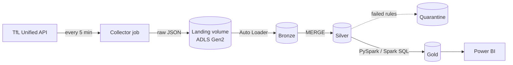

# PulseCity SmartGrid

[](https://github.com/aaronsunny007/pulsegrid-belfast-smart-city-intelligence/actions/workflows/ci.yml)

**A transport reliability lakehouse on Azure Databricks.** PulseCity polls the live status of
every London Underground, Elizabeth line, DLR and Overground line every 5 minutes, builds a
Bronze/Silver/Gold lakehouse in Unity Catalog on ADLS Gen2, and measures how reliably each line
actually ran, based on status history rather than hand-set scores.

London is the first city. The pipeline is driven by per-city config, so other cities (Belfast is
next on the roadmap) plug into the same tables.

**Questions it answers**
- Which lines were least reliable this week, and is that getting better or worse?
- How long does each line take to recover from an incident?
- When in the day do disruptions start, and do weekends differ from weekdays?
- How much of the network was closed for planned engineering works, separately from failures?
- Can the numbers be trusted? How complete was data collection each day?

---

## Architecture



| Layer | What it holds | How it is built |
|---|---|---|
| Landing | One raw JSON file per poll | Python collector, atomic writes to a Unity Catalog volume |
| Bronze | Raw payloads + lineage, append-only | Auto Loader, `availableNow`, checkpointed |
| Silver | One typed row per line status | Explicit schema, quality rules, quarantine, idempotent `MERGE` |
| Gold | Facts, incidents, daily scores, dims | Window functions, SCD Type 2, incremental `replaceWhere` |

More detail: [docs/architecture.md](docs/architecture.md)

## Tech stack

| | |
|---|---|
| Cloud | Microsoft Azure |
| Compute | Azure Databricks (serverless jobs) |
| Processing | PySpark, Spark SQL, Apache Spark 4 |
| Storage | Azure Data Lake Storage Gen2, Delta Lake |
| Governance | Unity Catalog (catalog, schemas, volumes, external location) |
| Orchestration and deployment | Databricks Workflows, Databricks Asset Bundles |
| BI | Power BI (composite model over a Databricks SQL warehouse) |
| Quality | pytest (42 tests on local Spark + Delta), ruff, GitHub Actions |
| Language | Python 3.10+ |

## Engineering highlights

- **Incremental ingestion.** Auto Loader discovers only new files. Streaming checkpoints feed
  Silver, and Gold is rebuilt for a lookback window only.
  ([pipeline.py](src/pulsecity/pipeline.py))
- **Schema enforced once.** Bronze stores the raw response, so a TfL schema change can't break
  ingestion. Silver parses with an explicit `StructType`. ([schemas.py](src/pulsecity/schemas.py))
- **Data quality with quarantine.** Failed polls and rows that break rules are kept with the
  reasons they failed, not dropped. ([quality.py](src/pulsecity/quality.py))
- **Idempotent by design.** Every step can be re-run safely, and a test checks that re-running
  changes no row counts. ([test_pipeline_e2e.py](tests/test_pipeline_e2e.py))
- **Incident detection** with a gaps-and-islands window query: consecutive disrupted polls
  become one incident, split at collector outages. ([gold.py](src/pulsecity/gold.py))
- **SCD Type 2** `dim_line` in a single Delta `MERGE`, so line renames (like the 2024 London
  Overground split) keep their history. ([delta_utils.py](src/pulsecity/delta_utils.py))
- **Time handled properly.** Everything is stored in UTC. The service day starts at 04:00
  London time, and tests cover both BST and GMT.
- **Planned works kept separate from failures**, so engineering closures don't distort
  reliability.
- **Gaps are visible.** Collector outages lower `coverage_pct` instead of silently counting
  as good or bad service.
- **Infrastructure as code.** One `databricks bundle deploy` creates the wheel and all three
  jobs. CI runs lint, tests and a wheel build on every push.

## The reliability score

```
reliability_score = 100 × (1 − Σ(minutes × unplanned impact) / observed minutes)
```

Each TfL status has an impact weight (Minor Delays 0.25, Severe Delays 0.6, Suspended 1.0, ...).
Ten minutes of severe delays in an hour gives 100 × (1 − 6/60) = **90.0**. Full method, weights
and limitations: [docs/reliability_methodology.md](docs/reliability_methodology.md)

## Gold data model

| Table | Grain |
|---|---|
| `fact_line_status` | line × poll |
| `fact_disruption_incident` | incident |
| `agg_line_reliability_daily` | line × service day |
| `agg_network_health_hourly` | hour |
| `line_status_current`, `v_live_alerts` | line (latest) |
| `dim_line` (SCD2), `dim_date`, `dim_status_severity` | dimensions |

Column definitions: [docs/data_dictionary.md](docs/data_dictionary.md)

## Run it locally (no Azure needed)

Needs Python 3.10+ and Java 17+.

```bash
make install
```

```bash
make test
```

```bash
make demo
```

`make demo` generates two days of **synthetic** TfL-shaped data (a Friday with incidents, a
collector outage and a failed API call, then a Saturday with planned works) and runs the full
pipeline on local Spark + Delta:

```
== Daily line reliability (worst first) ==
|service_date|line_name     |reliability_score|risk_level   |incidents|unplanned_impact_min|planned_impact_min|coverage_pct|
|2026-10-16  |Central       |97.48            |Moderate Risk|1        |33.3                |0.0               |97.8        |
|2026-10-16  |Elizabeth line|97.84            |Moderate Risk|1        |24.0                |0.0               |97.4        |
|2026-10-16  |District      |98.65            |Stable       |1        |15.0                |0.0               |97.4        |
...
|2026-10-17  |Piccadilly    |97.08            |Moderate Risk|1        |42.0                |0.0               |100.0       |
|2026-10-17  |Jubilee       |100.0            |Stable       |0        |0.0                 |555.0             |100.0       |
```

The synthetic data exists only for tests and this demo. On Databricks, the same code runs on
real TfL data from the collector.

## Deploy to Azure

Step-by-step guide: [docs/azure_setup.md](docs/azure_setup.md). In short:

```bash
databricks bundle deploy -t prod
```

```bash
databricks bundle run -t prod pulsecity_setup
```

Power BI model, DAX measures and page layout: [docs/powerbi.md](docs/powerbi.md).
Example Spark SQL analysis: [notebooks/reliability_analysis.sql](notebooks/reliability_analysis.sql).

## Repository layout

```
├── databricks.yml              Asset Bundle (targets dev / prod)
├── resources/jobs.yml          collector, pipeline and setup jobs
├── src/pulsecity/
│   ├── cities/london.yml       city config
│   ├── sources/tfl.py          TfL API client
│   ├── landing.py              collector: raw envelopes to the landing volume
│   ├── bronze.py               Auto Loader ingestion
│   ├── silver.py               parsing and quality rules
│   ├── gold.py                 facts, incidents, scores
│   ├── delta_utils.py          MERGE upsert, SCD2, replaceWhere
│   ├── pipeline.py             steps that read and write tables
│   ├── jobs.py                 job entry points
│   └── demo.py                 offline demo
├── tests/                      42 tests, local Spark 4 + Delta
├── notebooks/                  Spark SQL analysis
├── docs/                       architecture, method, setup, Power BI, data dictionary
└── archive/v1/                 the original prototype, kept for reference
```

## Roadmap

- [x] Live TfL status collection, Bronze/Silver/Gold, reliability score, incidents
- [x] Tests, CI, Asset Bundle deployment
- [ ] Power BI report on two or more weeks of real data
- [ ] Excess Wait Time from TfL arrival predictions (measures gaps between trains directly)
- [ ] Station dimension with coordinates, for a map view
- [ ] Belfast: Translink Metro and Glider timetables (GTFS) and Belfast Bikes from OpenDataNI,
      as a second city config
