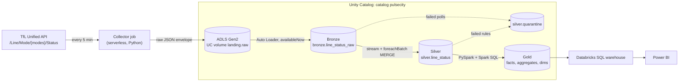

# Architecture



## Jobs

| Job | Schedule | Tasks |
|---|---|---|
| `pulsecity-collector-london` | every 5 min | `collect_status`: one TfL call, one landing file |
| `pulsecity-pipeline-london` | hourly at :07 | `ingest_bronze` → `build_silver` → `build_gold` |
| `pulsecity-setup` | once | catalog, schemas, volumes, severity reference table |

All jobs run the same Python wheel on serverless compute and are deployed with a
Databricks Asset Bundle (`databricks.yml`, `resources/jobs.yml`).

## Design decisions

**Collector separate from the pipeline.** Polling has to happen on a fixed cadence and must not
be delayed by a slow transform. Landing raw files decouples the two: if the pipeline fails, polls
keep accumulating and are processed on the next run.

**Raw payload kept as text in Bronze.** Bronze never fails on a TfL schema change. The schema is
enforced once, in Silver, with an explicit `StructType` (`src/pulsecity/schemas.py`). Fields TfL
adds are ignored; fields TfL drops become NULL and are caught by the quality rules.

**Atomic landing writes.** The collector writes `.name.tmp` and renames it. Spark skips files that
start with `.`, so Auto Loader never reads a half-written file.

**Failed polls are data.** If TfL is down, the collector still lands an envelope with
`http_status = 0` and then fails the job (so alerts fire). Silver quarantines it, and Gold shows the
gap as lower `coverage_pct` instead of pretending service was good or bad.

**Idempotency everywhere.** Auto Loader and streaming checkpoints process each file once. Silver
uses `MERGE` on `(snapshot_id, line_id, status_seq)`, so replaying a batch changes nothing. Gold is
rebuilt for a lookback window with `replaceWhere`. Every step can be re-run safely.

**Incremental Gold, with one exception.** The per-poll fact and the daily and hourly aggregates
are rebuilt for the last N service days (default 3). Incidents are rebuilt in full from the fact
table: it is small (about 7,000 rows per day), and a full pass is the simplest correct way to
join up incidents that cross the incremental window.

**Service day, not calendar day.** Trains run past midnight. A service day starts at 04:00
London time, derived from UTC with `from_utc_timestamp`, so BST and GMT both work. Tests cover
both sides of the clock change.

**Pure transforms.** Every function in `bronze.py`, `silver.py` and `gold.py` is
DataFrame-in, DataFrame-out with no I/O. That is what makes 40+ local tests possible.
Reading and writing tables lives in `pipeline.py`.

**Configuration over code for cities.** City-specific values (time zone, modes, poll interval,
risk bands) live in `src/pulsecity/cities/<city>.yml`. Window functions are partitioned by
`city`, so a second city can share the same tables.

## Unity Catalog layout

```
pulsecity                 (catalog, managed location on ADLS Gen2)
├── landing   volume raw          raw JSON envelopes   /Volumes/pulsecity/landing/raw/<city>/<dataset>/ingest_date=YYYY-MM-DD/
├── bronze    line_status_raw
├── silver    line_status, quarantine
├── gold      fact_*, agg_*, dim_*, line_status_current, v_live_alerts, v_line_reliability_7d
└── ops       run_log, volume checkpoints
```
